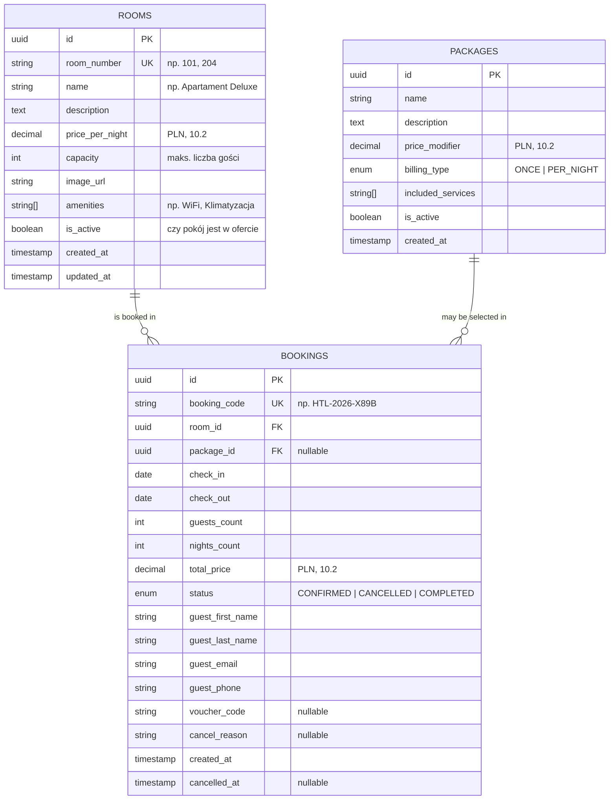

# Hotel C – architektura systemu

Dokument opisuje stos technologiczny, strukturę repozytorium, model danych
oraz kluczowe reguły biznesowe systemu rezerwacji pokoi i pakietów
wypoczynkowych. Kontrakt REST API opisuje osobny dokument
(`docs/api-contract.md`, zadanie HOTEL-10).

## 1. Stos technologiczny

| Warstwa            | Technologia                              | Uzasadnienie                                                        |
| ------------------ | ---------------------------------------- | ------------------------------------------------------------------- |
| Frontend           | React + TypeScript + Vite                | Istniejący prototyp wyszukiwarki pokoi (HOTEL-7).                   |
| Backend            | NestJS (Node.js + TypeScript)            | Modularna architektura, spójne typy z frontendem, wbudowana walidacja. |
| Baza danych        | PostgreSQL 16                            | Transakcje, ograniczenia integralności, typy zakresów dat.          |
| ORM                | Prisma                                   | Migracje, bezpieczeństwo typów, skrypt seed.                        |
| Walidacja          | class-validator + class-transformer      | Deklaratywna walidacja DTO na wejściu API.                          |
| Dokumentacja API   | Swagger / OpenAPI (`@nestjs/swagger`)    | Generowana automatycznie pod `/api/docs`.                           |
| Testy              | Vitest + Supertest                       | Testy jednostkowe i e2e (domyślne narzędzia NestJS 12).             |
| Analiza statyczna  | oxlint                                   | Szybki lint z regułami uwzględniającymi typy (domyślny w NestJS 12). |
| CI                 | GitHub Actions                           | Osobne workflow dla `frontend/` i `backend/`.                       |
| Środowisko lokalne | Docker Compose                           | Baza danych uruchamiana jedną komendą.                              |

## 2. Struktura repozytorium (monorepo)

```text
projekt-c-hotel/
├── .github/workflows/
│   ├── frontend-ci.yml        # lint, testy i build frontendu
│   └── backend-ci.yml         # lint, testy i build backendu
├── docs/                      # dokumentacja projektowa
├── frontend/                  # React + Vite
├── backend/                   # NestJS
│   ├── prisma/                # schemat bazy i migracje (seed.ts dojdzie w HOTEL-6)
│   ├── src/
│   │   ├── common/            # filtry, interceptory, wspólne DTO (dojdzie w HOTEL-10)
│   │   ├── config/            # konfiguracja i walidacja zmiennych środowiskowych
│   │   ├── modules/           # moduły domenowe: na razie health, kolejne w HOTEL-6 i HOTEL-5
│   │   ├── prisma/            # moduł dostępu do bazy danych
│   │   ├── app.setup.ts       # wspólna konfiguracja: prefiks API, CORS, walidacja, Swagger
│   │   └── main.ts            # uruchomienie aplikacji
│   └── test/                  # testy e2e
├── docker-compose.yml         # PostgreSQL dla środowiska lokalnego
└── .env.example               # zmienne dla docker-compose
```

## 3. Architektura backendu

Backend jest monolitem modularnym. Każdy moduł domenowy ma tę samą budowę:

```text
Controller  ->  Service  ->  PrismaService  ->  PostgreSQL
(HTTP, DTO)    (logika)     (dostęp do danych)
```

- **Controller** odpowiada wyłącznie za warstwę HTTP: routing, DTO i dokumentację Swagger.
- **Service** zawiera reguły biznesowe (dostępność, wycena, rezerwacja, anulacja).
- **PrismaService** to jedyna warstwa komunikująca się z bazą danych.

Konwencje:

- Wszystkie endpointy mają prefiks `/api/v1`.
- Dokumentacja Swagger jest dostępna pod `/api/docs`.
- Dane wejściowe są walidowane globalnym `ValidationPipe`
  (`whitelist`, `forbidNonWhitelisted`, `transform`).
- Kod i nazwy w API są w języku angielskim.

Moduły domenowe (dodawane w kolejnych zadaniach):

| Moduł          | Odpowiedzialność                                         | Zadanie |
| -------------- | -------------------------------------------------------- | ------- |
| `health`       | Stan aplikacji i bazy danych (`/api/v1/health`)          | HOTEL-12 |
| `rooms`        | Wyszukiwanie pokoi, szczegóły pokoju, dostępność         | HOTEL-6 |
| `packages`     | Lista pakietów wypoczynkowych                            | HOTEL-6 |
| `bookings`     | Tworzenie i anulowanie rezerwacji, wycena pobytu         | HOTEL-5 |
| `integrations` | Endpointy dla zespołów: masaże, fitness, vouchery        | HOTEL-5 |

## 4. Model danych

Schemat źródłowy: `backend/prisma/schema.prisma`.



### Ograniczenia integralności w bazie

Poza ograniczeniami modelowanymi przez Prismę migracja początkowa dodaje
ręcznie następujące reguły (Prisma nie potrafi ich opisać w schemacie):

| Ograniczenie              | Znaczenie                                                                 |
| ------------------------- | ------------------------------------------------------------------------- |
| `bookings_dates_check`    | Data wyjazdu musi być późniejsza niż data przyjazdu.                      |
| `bookings_guests_check`   | Liczba gości musi być dodatnia.                                           |
| `bookings_no_overlap`     | Constraint `EXCLUDE`: ten sam pokój nie może mieć dwóch potwierdzonych rezerwacji o nakładających się datach. |

## 5. Reguły biznesowe

### BR-1: Dostępność pokoju

Status „wolny/zajęty” nie jest przechowywany w tabeli `rooms`. Jest wyliczany
dla zadanego terminu na podstawie tabeli `bookings`. Dzięki temu pokój zajęty
dzisiaj można normalnie zarezerwować na przyszły miesiąc.

Pokój jest dostępny w terminie `[newCheckIn, newCheckOut)`, jeżeli nie istnieje
żadna rezerwacja o statusie `CONFIRMED` dla tego pokoju, która spełnia warunek:

```text
existing.checkIn < newCheckOut  AND  existing.checkOut > newCheckIn
```

Przedziały są prawostronnie otwarte: dzień wyjazdu jednego gościa może być
dniem przyjazdu kolejnego. Rezerwacje anulowane (`CANCELLED`) nie blokują terminu.

### BR-2: Ochrona przed podwójną rezerwacją

Samo sprawdzenie dostępności w transakcji nie wystarcza, bo dwa równoległe
żądania mogą przejść sprawdzenie jednocześnie. Gwarancję daje constraint
`bookings_no_overlap` w PostgreSQL. Serwis tłumaczy naruszenie constraintu
na odpowiedź `409 Conflict`.

### BR-3: Wycena pobytu

```text
nightsCount  = checkOut - checkIn            (w dniach, minimum 1)
roomCost     = nightsCount * room.pricePerNight
packageCost  = package.billingType == ONCE      ? package.priceModifier
             : package.billingType == PER_NIGHT ? package.priceModifier * nightsCount
             : 0                                (brak pakietu)
totalPrice   = roomCost + packageCost
```

Cena pakietu nie zależy od liczby gości (założenie do potwierdzenia).

### BR-4: Warunki utworzenia rezerwacji

- `checkOut` jest późniejsze niż `checkIn`.
- `checkIn` nie jest wcześniejsze niż dzisiejsza data w strefie `Europe/Warsaw`.
- Pokój istnieje, jest aktywny (`isActive`) i `capacity >= guestsCount`.
- Wybrany pakiet (jeśli podano) istnieje i jest aktywny.

### BR-5: Kod rezerwacji i anulacja

- Każda rezerwacja otrzymuje unikalny, czytelny kod w formacie `HTL-<rok>-<4 znaki>`.
- Gość anuluje rezerwację, podając parę: kod rezerwacji i adres e-mail.
  Dzięki temu system nie wymaga kont użytkowników.
- Anulacja zmienia status na `CANCELLED`, zapisuje `cancelledAt`
  i zwalnia termin pokoju w wyszukiwarce.

## 6. Uruchomienie lokalne

Wymagania: Node.js 22 lub nowszy, Docker z Docker Compose.

```bash
# 1. Baza danych
cp .env.example .env
docker compose up -d

# 2. Backend
cd backend
cp .env.example .env
npm ci
npx prisma generate
npx prisma migrate deploy
npm run start:dev
```

Po starcie:

- API: `http://localhost:3000/api/v1`
- Swagger: `http://localhost:3000/api/docs`
- Stan aplikacji i bazy: `http://localhost:3000/api/v1/health`

## 7. Konwencje pracy

- Branche: `feature/HOTEL-<numer>-<krótki-opis>`.
- Commity po angielsku, w standardzie Conventional Commits:
  `<typ>: <krótki opis w trybie rozkazującym>`, gdzie typ to `feat`, `fix`,
  `docs`, `chore`, `ci` lub `test` (np. `feat: add room search endpoint`).
- Każda zmiana trafia do `main` przez Pull Request z przechodzącym CI.

## 8. Decyzje do uzgodnienia (HOTEL-10)

| Temat                       | Propozycja                                                           |
| --------------------------- | -------------------------------------------------------------------- |
| Format kwot w JSON          | Liczba (`number`) z dwoma miejscami po przecinku.                    |
| Semantyka `voucherCode`     | W MVP tylko zapisywany przy rezerwacji; zniżki do ustalenia z grupą Vouchery. |
| Autoryzacja integracji      | Wspólny klucz w nagłówku `X-API-Key` dla zespołów zewnętrznych.      |
| Status `COMPLETED`          | Do decyzji: usunąć albo wyliczać z dat. Brak procesu, który go ustawia. |
| Format błędów API           | Jednolity obiekt `statusCode`, `error`, `message`, `details[]`.      |
