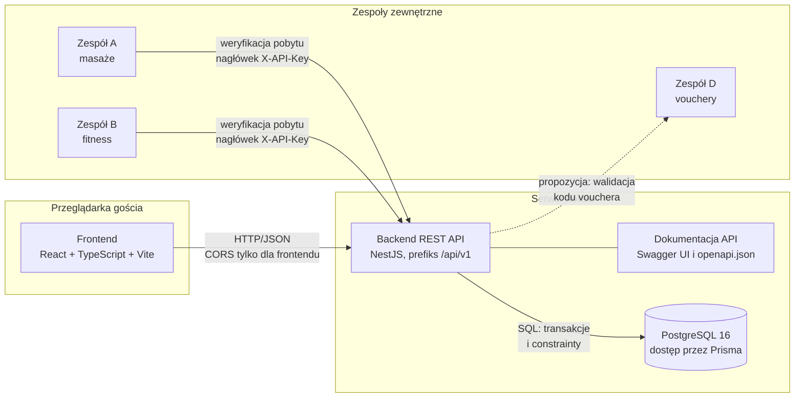
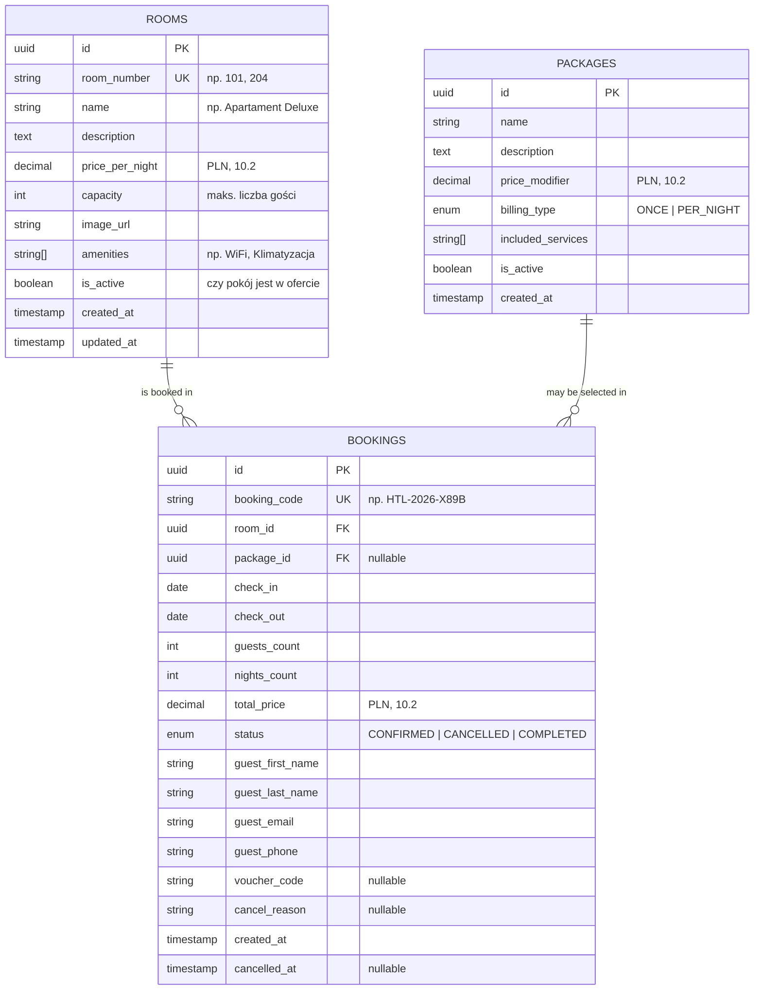

# Hotel C – architektura systemu

Dokument opisuje stos technologiczny, architekturę systemu z podziałem odpowiedzialności,
uzasadnienie decyzji, strukturę repozytorium, model danych oraz kluczowe reguły biznesowe systemu
rezerwacji pokoi i pakietów wypoczynkowych. Kontrakt REST API opisuje osobny dokument
(`docs/api-contract.md`, zadanie HOTEL-10).

## 1. Stos technologiczny

| Warstwa            | Technologia                              | Uzasadnienie                                                        |
| ------------------ | ---------------------------------------- | ------------------------------------------------------------------- |
| Frontend           | React + TypeScript + Vite                | Istniejący prototyp wyszukiwarki pokoi (HOTEL-7).                   |
| Backend            | NestJS (Node.js + TypeScript)            | Modularna architektura, spójne typy z frontendem, wbudowana walidacja. |
| Baza danych        | PostgreSQL 16                            | Transakcje, ograniczenia integralności, typy zakresów dat.          |
| ORM                | Prisma                                   | Migracje, bezpieczeństwo typów, skrypt seed.                        |
| Walidacja          | class-validator + class-transformer      | Deklaratywna walidacja DTO na wejściu API.                          |
| Dokumentacja API   | Swagger / OpenAPI (`@nestjs/swagger`)    | Generowana automatycznie pod `/api/docs`.                           |
| Testy              | Vitest + Supertest                       | Testy jednostkowe, e2e i integracyjne na prawdziwym PostgreSQL.     |
| Bezpieczeństwo API | `@nestjs/throttler`, klucze API          | Limit żądań na adres IP i uwierzytelnianie zespołów zewnętrznych.   |
| Analiza statyczna  | oxlint                                   | Szybki lint z regułami uwzględniającymi typy (domyślny w NestJS 12). |
| CI                 | GitHub Actions                           | Osobne workflow dla `frontend/` i `backend/`.                       |
| Środowisko lokalne | Docker Compose                           | Baza danych uruchamiana jedną komendą.                              |

## 2. Architektura systemu



Linia przerywana to propozycja, której nie uzgodniono jeszcze z zespołem D. Pozostałe połączenia są
zaimplementowane. Frontend nigdy nie łączy się z bazą ani z zespołami zewnętrznymi: cała komunikacja
przechodzi przez backend.

### 2.1 Odpowiedzialności

| Komponent             | Odpowiada za                                                                                                                                  | Nie odpowiada za                                  |
| --------------------- | --------------------------------------------------------------------------------------------------------------------------------------------- | ------------------------------------------------- |
| Frontend              | Wyświetlanie ofert, formularze (wyszukiwania, rezerwacji, anulacji), pierwsza walidacja dla wygody użytkownika, pokazywanie błędów z API       | Cen, dostępności i reguł biznesowych, dostępu do bazy |
| Backend               | Wszystkie reguły biznesowe (dostępność, wycena, rezerwacja, anulacja), walidacja danych, kontrakt API i jego dokumentacja, uwierzytelnianie zespołów, limity żądań | Wyglądu aplikacji                                 |
| Baza danych           | Trwałość danych i ich integralność: klucze obce, ograniczenia `CHECK`, `EXCLUDE` blokujący podwójną rezerwację także przy równoległych żądaniach | Obliczania cen i reguł wyższego poziomu           |
| Zespoły A i B         | Własne usługi (masaże, fitness). Pytają nas o aktywny pobyt gościa i uprawnienia z pakietu                                                    | Zapisu rezerwacji i danych osobowych gości        |
| Zespół D              | Własne zasady vouchera. Do uzgodnienia: czy udostępnia walidację kodu i jaka zniżka z niego wynika                                            | Rezerwacji pokoi                                  |
| CI (GitHub Actions)   | Lint, testy (w tym na prawdziwym PostgreSQL) i build przy każdym Pull Requeście                                                               | Wdrożeń (jeszcze nie skonfigurowano)              |

### 2.2 Model komunikacji

Frontend, backend i baza łączą się w jednym kierunku: **przeglądarka → backend → baza**.

- Frontend rozmawia z backendem przez REST w formacie JSON. Serwer nie zapisuje sesji ani kont: gość
  anuluje rezerwację kodem i adresem e-mail.
- Backend przyjmuje żądanie w stałej kolejności: limit żądań, klucz API (tylko `/integrations/*`),
  walidacja DTO, kontroler, serwis, Prisma, PostgreSQL. Każdy błąd wraca w jednolitym formacie z polem `code`.
- Źródłem prawdy o API jest kontrakt (`docs/openapi.json`). Z niego frontend może wygenerować typy TypeScript,
  a test w CI pilnuje, żeby plik był zgodny z kodem.
- W produkcji ruch powinien iść przez HTTPS. Lokalnie używamy zwykłego HTTP.

Przykład: rezerwacja pokoju.

1. Gość wybiera daty, a frontend wywołuje `GET /api/v1/rooms?checkIn=…&checkOut=…&guests=…`.
2. Backend waliduje parametry, pyta bazę o pokoje i zajęte terminy (BR-1), liczy cenę (BR-3) i odsyła listę.
3. Gość wysyła formularz: `POST /api/v1/bookings`. Cena nie jest częścią żądania.
4. Backend w transakcji sprawdza pokój, pojemność, pakiet i dostępność, liczy cenę i zapisuje rezerwację.
   Gdyby dwa żądania przeszły sprawdzenie jednocześnie, constraint w bazie przepuści tylko jedno (BR-2),
   a drugie dostanie `409 ROOM_NOT_AVAILABLE`.
5. Odpowiedź zawiera kod rezerwacji. Gość używa go później do anulacji (`POST /api/v1/bookings/cancel`).

### 2.3 Integracje z zespołami A, B i D

| Zespół        | Kierunek wywołania     | Mechanizm                                                         | Stan                                                                 |
| ------------- | ---------------------- | ----------------------------------------------------------------- | -------------------------------------------------------------------- |
| A (masaże)    | zespół A → nasze API   | `GET /api/v1/integrations/bookings/{kod}/verification`, `X-API-Key` | Gotowe po naszej stronie. Do uzgodnienia: klucz i kody usług `MASSAGE_*` |
| B (fitness)   | zespół B → nasze API   | jak wyżej                                                         | Gotowe po naszej stronie. Do uzgodnienia: klucz i kody usług `FITNESS_*` |
| D (vouchery)  | nasze API → zespół D   | Obecnie `voucherCode` jest tylko zapisywany przy rezerwacji. Docelowo wywołanie serwer-serwer do API zespołu D | Wymaga uzgodnienia kontraktu z zespołem D                            |

Zasady wspólne dla wszystkich integracji:

- Wywołania idą tylko między serwerami, nigdy z przeglądarki, bo klucz API musi pozostać tajny.
- Każdy zespół ma własny klucz, który można wymienić bez wpływu na pozostałych.
- Odpowiedzi dla partnerów nie zawierają danych osobowych gości.
- Kody usług w pakietach (`includedServices`) są stałe, bo partnerzy rozpoznają po nich usługę.
- Zmiany kontraktu przechodzą przez Pull Request i aktualizację `docs/openapi.json`.

Szczegóły i przykłady: [api-contract.md](api-contract.md), sekcje 3.6 i 5.

## 3. Uzasadnienie decyzji

Decyzje są zaimplementowane w repozytorium. Formalne potwierdzenie przez zespół (Paweł, zespoły A, B i D)
śledzi tabela w [api-contract.md](api-contract.md), sekcja 7.

| # | Obszar                       | Wybór                                                         | Dlaczego                                                                                                                                              | Rozważone alternatywy                                                                                                  |
| - | ---------------------------- | ------------------------------------------------------------- | ----------------------------------------------------------------------------------------------------------------------------------------------------- | ---------------------------------------------------------------------------------------------------------------------- |
| 1 | Frontend                     | React, TypeScript, Vite                                       | Prototyp wyszukiwarki z testami i CI już istnieje (HOTEL-7). TypeScript pozwala współdzielić typy z backendem przez kontrakt OpenAPI.                  | Angular, Vue, Next.js: brak powodu do przepisywania działającego prototypu, a renderowanie po stronie serwera nie jest potrzebne |
| 2 | Backend i sposób udostępniania API | NestJS, REST/JSON pod `/api/v1`, dokumentacja OpenAPI    | Ten sam język co frontend. Moduły, wstrzykiwanie zależności i walidacja DTO są wbudowane. Dokumentacja powstaje z kodu, więc nie może się z nim rozjechać. REST jest zrozumiały dla partnerów i testerów (Swagger, Insomnia). | Czysty Express (brak struktury), Spring Boot (inny język niż frontend), GraphQL (zbyt rozbudowany dla kilku zasobów i trudniejszy dla partnerów) |
| 3 | System zarządzania bazą danych | PostgreSQL 16 z ORM Prisma                                  | Constraint `EXCLUDE` na zakresach dat daje gwarancję braku podwójnych rezerwacji nawet przy równoległych żądaniach. Pełne transakcje i dokładne liczby dziesiętne dla kwot. Prisma daje typowanego klienta i migracje. | MySQL i SQLite (brak takiego constraintu, ochrona tylko w aplikacji), MongoDB (brak relacyjnej integralności), TypeORM (słabsze typowanie niż klient generowany przez Prisma) |
| 4 | Model komunikacji            | Przeglądarka → backend → baza, REST bez sesji                 | Jedna warstwa z regułami biznesowymi, której nie da się obejść z przeglądarki. Gość nie potrzebuje konta: wystarcza kod rezerwacji i e-mail.           | Bezpośredni dostęp frontendu do bazy (brak kontroli reguł), konta użytkowników i WebSocket (poza zakresem, brak potrzeby czasu rzeczywistego) |
| 5 | Integracja z zespołami A, B, D | REST serwer-serwer z kluczem `X-API-Key` dla każdego zespołu | Prosty mechanizm, wystarczający dla kilku zaufanych systemów. Osobne klucze pozwalają wymienić jeden bez wpływu na resztę.                              | OAuth (zbyt ciężki dla 2–3 zespołów), wspólna baza (wiąże zespoły ze schematem), webhooki (brak potrzeby)               |
| 6 | Lokalne uruchamianie         | Docker Compose dla bazy, Node.js 22+ na maszynie, seed z danymi demo | Każdy dostaje tę samą wersję bazy jednym poleceniem, a kod uruchamia się szybko bez przebudowy kontenerów. Seed daje gotowe dane do testów.             | Całość w kontenerach (wolniejsza praca nad kodem), lokalnie instalowany PostgreSQL (różne wersje u członków zespołu)    |

Pełna instrukcja uruchomienia: sekcja 8.

## 4. Struktura repozytorium (monorepo)

```text
projekt-c-hotel/
├── .github/workflows/
│   ├── frontend-ci.yml        # lint, testy i build frontendu
│   └── backend-ci.yml         # lint, testy i build backendu
├── docs/                      # dokumentacja: architektura, kontrakt API, openapi.json
├── frontend/                  # React + Vite
├── backend/                   # NestJS
│   ├── prisma/                # schemat bazy i migracje (seed.ts dojdzie w HOTEL-6)
│   ├── src/
│   │   ├── common/            # format błędów, filtr wyjątków, walidatory, stałe
│   │   ├── config/            # konfiguracja i walidacja zmiennych środowiskowych
│   │   ├── modules/           # moduły domenowe: na razie health, kolejne w HOTEL-6 i HOTEL-5
│   │   ├── prisma/            # moduł dostępu do bazy danych
│   │   ├── app.setup.ts       # wspólna konfiguracja: prefiks API, CORS, walidacja, Swagger
│   │   └── main.ts            # uruchomienie aplikacji
│   └── test/                  # testy e2e
├── docker-compose.yml         # PostgreSQL dla środowiska lokalnego
└── .env.example               # zmienne dla docker-compose
```

## 5. Architektura backendu

Backend jest monolitem modularnym. Każdy moduł domenowy ma tę samą budowę:

```text
Controller  ->  Service  ->  PrismaService  ->  PostgreSQL
(HTTP, DTO)    (logika)     (dostęp do danych)
```

- **Controller** odpowiada wyłącznie za warstwę HTTP: routing, DTO i dokumentację Swagger.
- **Service** zawiera reguły biznesowe (dostępność, wycena, rezerwacja, anulacja).
- **PrismaService** to jedyna warstwa komunikująca się z bazą danych.

Konwencje:

- Wszystkie endpointy mają prefiks `/api/v1`.
- Dokumentacja Swagger jest dostępna pod `/api/docs`.
- Dane wejściowe są walidowane globalnym `ValidationPipe` (nieznane pola są odrzucane,
  jeden komunikat na pole, konwersja na typy z DTO).
- Każdy błąd ma jednolity format z polem `code` (patrz [api-contract.md](api-contract.md)).
- Kod i nazwy w API są w języku angielskim.

Kontrakt wszystkich modułów (endpointy, DTO, walidacja) jest gotowy od zadania HOTEL-10.
Wszystkie moduły mają zaimplementowaną logikę i testy na prawdziwej bazie danych.

Moduły domenowe i zadania, w których powstaje ich logika:

| Moduł          | Odpowiedzialność                                         | Implementacja |
| -------------- | -------------------------------------------------------- | ------------- |
| `health`       | Stan aplikacji i bazy danych (`/api/v1/health`)          | gotowy (HOTEL-12) |
| `rooms`        | Wyszukiwanie pokoi, szczegóły pokoju, dostępność         | gotowy (HOTEL-6) |
| `packages`     | Lista pakietów wypoczynkowych                            | gotowy (HOTEL-6) |
| `bookings`     | Tworzenie i anulowanie rezerwacji, wycena pobytu         | gotowy (HOTEL-5) |
| `integrations` | Endpointy dla zespołów: masaże, fitness, vouchery        | gotowy (HOTEL-5) |

## 6. Model danych

Schemat źródłowy: `backend/prisma/schema.prisma`.



### Ograniczenia integralności w bazie

Poza ograniczeniami modelowanymi przez Prismę migracja początkowa dodaje
ręcznie następujące reguły (Prisma nie potrafi ich opisać w schemacie):

| Ograniczenie              | Znaczenie                                                                 |
| ------------------------- | ------------------------------------------------------------------------- |
| `bookings_dates_check`    | Data wyjazdu musi być późniejsza niż data przyjazdu.                      |
| `bookings_guests_check`   | Liczba gości musi być dodatnia.                                           |
| `bookings_no_overlap`     | Constraint `EXCLUDE`: ten sam pokój nie może mieć dwóch potwierdzonych rezerwacji o nakładających się datach. |

## 7. Reguły biznesowe

### BR-1: Dostępność pokoju

Status „wolny/zajęty” nie jest przechowywany w tabeli `rooms`. Jest wyliczany
dla zadanego terminu na podstawie tabeli `bookings`. Dzięki temu pokój zajęty
dzisiaj można normalnie zarezerwować na przyszły miesiąc.

Pokój jest dostępny w terminie `[newCheckIn, newCheckOut)`, jeżeli nie istnieje
żadna rezerwacja o statusie `CONFIRMED` dla tego pokoju, która spełnia warunek:

```text
existing.checkIn < newCheckOut  AND  existing.checkOut > newCheckIn
```

Przedziały są prawostronnie otwarte: dzień wyjazdu jednego gościa może być
dniem przyjazdu kolejnego. Rezerwacje anulowane (`CANCELLED`) nie blokują terminu.

### BR-2: Ochrona przed podwójną rezerwacją

Samo sprawdzenie dostępności w transakcji nie wystarcza, bo dwa równoległe
żądania mogą przejść sprawdzenie jednocześnie. Gwarancję daje constraint
`bookings_no_overlap` w PostgreSQL. Serwis tłumaczy naruszenie constraintu
na odpowiedź `409 Conflict`.

### BR-3: Wycena pobytu

```text
nightsCount  = checkOut - checkIn            (w dniach, minimum 1)
roomCost     = nightsCount * room.pricePerNight
packageCost  = package.billingType == ONCE      ? package.priceModifier
             : package.billingType == PER_NIGHT ? package.priceModifier * nightsCount
             : 0                                (brak pakietu)
totalPrice   = roomCost + packageCost
```

Cena pakietu nie zależy od liczby gości (założenie do potwierdzenia).

### BR-4: Warunki utworzenia rezerwacji

- `checkOut` jest późniejsze niż `checkIn`.
- `checkIn` nie jest wcześniejsze niż dzisiejsza data w strefie `Europe/Warsaw`.
- Pokój istnieje, jest aktywny (`isActive`) i `capacity >= guestsCount`.
- Wybrany pakiet (jeśli podano) istnieje i jest aktywny.

### BR-5: Kod rezerwacji i anulacja

- Każda rezerwacja otrzymuje unikalny, czytelny kod w formacie `HTL-<rok>-<4 znaki>`.
- Gość anuluje rezerwację, podając parę: kod rezerwacji i adres e-mail.
  Dzięki temu system nie wymaga kont użytkowników.
- Anulacja zmienia status na `CANCELLED`, zapisuje `cancelledAt`
  i zwalnia termin pokoju w wyszukiwarce.

## 8. Uruchomienie lokalne

Wymagania: Node.js 22 lub nowszy, Docker z Docker Compose.

```bash
# 1. Baza danych
cp .env.example .env
docker compose up -d

# 2. Backend
cd backend
cp .env.example .env
npm ci
npx prisma generate
npx prisma migrate deploy
npm run db:seed
npm run start:dev
```

Po starcie:

- API: `http://localhost:3000/api/v1`
- Swagger: `http://localhost:3000/api/docs`
- Stan aplikacji i bazy: `http://localhost:3000/api/v1/health`

## 9. Konwencje pracy

- Branche: `feature/HOTEL-<numer>-<krótki-opis>`.
- Commity po angielsku, w standardzie Conventional Commits:
  `<typ>: <krótki opis w trybie rozkazującym>`, gdzie typ to `feat`, `fix`,
  `docs`, `chore`, `ci` lub `test` (np. `feat: add room search endpoint`).
- Każda zmiana trafia do `main` przez Pull Request z przechodzącym CI.

## 10. Decyzje do uzgodnienia

Lista otwartych decyzji wraz ze statusem akceptacji przez zespoły jest prowadzona
w jednym miejscu: [api-contract.md](api-contract.md), sekcja 6.
